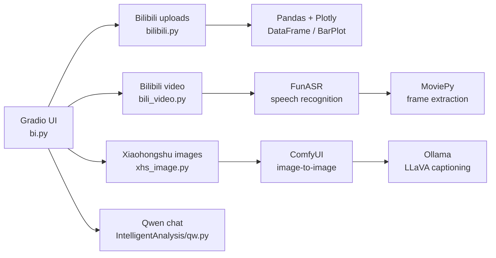

# Intelligent Data Visualization Platform Based on Pandas and Gradio

[简体中文](README.md) | English


A hands-on project that brings **Bilibili data collection, interactive visualization, LLM-powered analysis, video speech recognition and keyframe extraction, Xiaohongshu (RED) content collection, and ComfyUI image generation** into a single Gradio interface. It demonstrates an end-to-end workflow from data acquisition and insight generation to AI-assisted content creation, and can serve as a learning reference or prototype for Pandas, Gradio, and local AI integration.

> **Project status:** Prototype / educational project. Some workflows depend on the local machine and third-party services. Read [Configuration](#configuration) and [Security and Compliance](#security-and-compliance) before the first run.

## Table of Contents

- [Overview](#overview)
- [Features](#features)
- [Architecture](#architecture)
- [Project Structure](#project-structure)
- [Requirements](#requirements)
- [Getting Started](#getting-started)
- [Configuration](#configuration)
- [Running the Application](#running-the-application)
- [Optional Scripts and Data Pipeline](#optional-scripts-and-data-pipeline)
- [Troubleshooting](#troubleshooting)
- [Known Limitations](#known-limitations)
- [Security and Compliance](#security-and-compliance)
- [License and Acknowledgements](#license-and-acknowledgements)

## Overview

The main entry point is `bi.py`. It provides a single Gradio page that can:

- fetch a Bilibili creator's uploads by `mid` and organize them with Pandas;
- compare play and comment counts across videos with Plotly bar charts;
- inject upload statistics into a Qwen conversation to generate content-operation suggestions;
- download a Bilibili video by `bvid`, transcribe it with FunASR, and extract frames at sentence timestamps;
- download images from a Xiaohongshu note and send them through a local ComfyUI image-to-image workflow;
- optionally persist data to Excel/MySQL and prepare a BI export.

> This is an integration example, not a production-ready SaaS system. Platform APIs, authentication cookies, and third-party models may change or expire.

## Features

| Module | Capability | Implementation |
| --- | --- | --- |
| Bilibili uploads | Enter a creator's `mid` and retrieve titles, play counts, comments, and other fields | WBI-signed requests and pagination in `bilibili.py` |
| Visualization | Display records in a DataFrame and render play/comment bar charts for selected titles | Gradio `DataFrame` and `BarPlot`, Pandas + Plotly |
| AI analysis | Chat-based analysis of video performance with operational suggestions | DashScope OpenAI-compatible API, `qwen-plus` |
| Video retrieval | Resolve and download a Bilibili video by `bvid` | Bilibili `view` and `playurl` APIs |
| Speech recognition | Chinese speech-to-text with sentence-level start/end timestamps | FunASR `paraformer-zh`, `fsmn-vad`, `ct-punc-c` |
| Frame extraction | Capture one frame near the center of each sentence and pair it with its caption | MoviePy |
| Xiaohongshu collection | Extract note title and images and download them locally | Parse the page's `__INITIAL_STATE__` payload |
| AI image generation | Transform collected images into pixel-art variants | ComfyUI WebSocket API + Ollama `llava:7b` |
| Data pipeline (optional) | Excel append, MySQL insert, play-growth calculation, scheduled job template | `parse_data`, `sava_data`, `parse_for_BI`, `schedule` |

### Typical Workflows

```text
Bilibili mid ──> upload data ──> title selection ──> bar charts / AI analysis
Bilibili bvid ─> video download ──> speech recognition ──> per-sentence frames ──> image/text gallery
Xiaohongshu URL ─> image collection ──> ComfyUI + Ollama ──> generated images
```

## Architecture



Core data flows:

1. **Upload analytics:** `mid` → Bilibili WBI API → Pandas DataFrame → title filtering → charts or Qwen analysis.
2. **Video understanding:** `bvid` → video API → local MP4 → FunASR → sentence timestamps → MoviePy frames → gallery.
3. **AI image generation:** Xiaohongshu images → local directory → ComfyUI `LoadImage` → Ollama caption → KSampler image-to-image → output directory.

## Project Structure

```text
.
├── bi.py                              # Main entry: integrated Gradio UI
├── bilibili.py                        # Bilibili collection, Excel/MySQL persistence, BI preprocessing
├── bili_video.py                      # Bilibili video download by bvid
├── IntelligentAnalysis/
│   ├── qw.py                          # Qwen wrapper (DashScope OpenAI-compatible API)
│   ├── speech.py                      # FunASR transcription and per-sentence frame extraction
│   ├── get_video.py                   # Xiaohongshu video downloader (legacy standalone flow)
│   ├── app2.py                        # Standalone video analysis UI
│   ├── app.py                         # Early, incomplete UI draft
│   └── second_video.py                # Ocean Engine creative video downloader
├── ImageGeneration/
│   ├── xhs_image.py                   # Xiaohongshu note image downloader
│   ├── websockets_api_example.py      # ComfyUI WebSocket client and workflow definition
│   ├── xhs_aigc.py                    # Standalone "collect + generate" UI
│   └── 图转图工作流.json              # Exported ComfyUI workflow (reference only)
├── README.md                          # Chinese documentation
└── README_EN.md                       # English documentation
```

Notes:

- `bi.py` is the recommended entry point.
- `IntelligentAnalysis/app2.py` is a standalone Xiaohongshu video analysis UI and can serve as a smaller example.
- `IntelligentAnalysis/app.py` is an early draft with incomplete calls; do not use it as an entry point.
- `ImageGeneration/xhs_aigc.py` is a standalone image collection and generation UI.
- The ComfyUI workflow is maintained as a Python dictionary in `websockets_api_example.py`. The JSON export is for reference; keep both in sync after changing nodes.

## Requirements

| Category | Requirement |
| --- | --- |
| Operating system | Windows 10/11 (the source contains Windows absolute paths; adapt for other systems) |
| Python | 3.10 or later |
| Network | Access to Bilibili, Xiaohongshu, and DashScope |
| Multimedia | FFmpeg installed and available on `PATH` (used by MoviePy/audio-video processing) |
| UI framework | Gradio (a recent 4.44+ or 5.x release is recommended) |
| Data stack | Pandas, Plotly, OpenPyXL |
| Speech recognition | FunASR, PyTorch/torchaudio; an NVIDIA GPU is recommended |
| Image generation | Local ComfyUI server (default `127.0.0.1:8188`) |
| Vision captioning | Local Ollama server (default `127.0.0.1:11434`) with `llava:7b` |
| LLM service | Alibaba Cloud Model Studio / DashScope API key |
| Database (optional) | MySQL 8.x for upload-data persistence |

## Getting Started

### 1. Clone the Repository

```bash
git clone https://github.com/zizheng615/Intelligent-Data-Visualization-Platform-Based-on-Pandas-and-Gradio.git
cd Intelligent-Data-Visualization-Platform-Based-on-Pandas-and-Gradio
```

### 2. Create a Virtual Environment

Windows PowerShell:

```powershell
python -m venv .venv
.\.venv\Scripts\Activate.ps1
python -m pip install --upgrade pip
```

macOS / Linux:

```bash
python3 -m venv .venv
source .venv/bin/activate
python -m pip install --upgrade pip
```

### 3. Install Python Dependencies

The repository does not currently include a `requirements.txt`. The following list is derived from the source imports:

```bash
pip install gradio pandas plotly requests openpyxl sqlalchemy pymysql schedule openai websocket-client funasr moviepy
```

Additional notes:

- The code uses `from moviepy import VideoFileClip`, which corresponds to **MoviePy 2.x**. Avoid installing 1.x.
- FunASR is sensitive to the PyTorch version. For GPU acceleration, install `torch` and `torchaudio` that match your CUDA setup following the [official PyTorch instructions](https://pytorch.org/get-started/locally/).
- The first speech-recognition run downloads the ASR, VAD, and punctuation models. This may take time depending on network speed.
- Once the environment is verified, generate and commit a `requirements.txt` to make the setup reproducible.

### 4. Prepare External Services

#### DashScope (Qwen)

1. Create an API key in the Alibaba Cloud Model Studio console.
2. Replace `api_key` in `IntelligentAnalysis/qw.py`, or change the code to read it from an environment variable.
3. The default model is `qwen-plus`; the endpoint is:

   ```text
   https://dashscope.aliyuncs.com/compatible-mode/v1
   ```

#### ComfyUI

1. Start ComfyUI and make sure it listens on `127.0.0.1:8188`.
2. Install the custom nodes required by the workflow:
   - an Ollama integration node that provides `OllamaVision`;
   - ComfyUI-Custom-Scripts, which provides `ShowText|pysssss`.
3. Place the checkpoint in ComfyUI's `models/checkpoints` directory and keep the filename consistent with the workflow:

   ```text
   pixelArtDiffusionXL_spriteShaper.safetensors
   ```

4. Confirm the ComfyUI output directory and update it in:
   - the return path in `ImageGeneration/websockets_api_example.py`;
   - `allowed_paths` in `bi.py` and `ImageGeneration/xhs_aigc.py`.

#### Ollama

```bash
ollama serve
ollama pull llava:7b
```

The `OllamaVision` node uses `http://127.0.0.1:11434` by default. If your port differs, update node `24`'s `url` in `websockets_api_example.py`.

#### FFmpeg

Install FFmpeg and verify it:

```bash
ffmpeg -version
```

#### Bilibili and Xiaohongshu Cookies

Both platforms require a valid login session or risk-control parameters. Obtain fresh cookies from your own browser session and replace the stale values in the source. Cookies expire and must never be committed to a public repository.

## Configuration

Configuration is currently hardcoded. Review and update the following before the first run:

| File | What to change | Notes |
| --- | --- | --- |
| `bi.py` | Static decorative image paths, `allowed_paths`, `share` | Default images live under the original author's `C:\Users\...` and `D:\数据自动化与可视化实战\...` paths; missing files can break the UI. `share=True` creates a public URL |
| `bilibili.py` | Bilibili cookies, Excel paths, MySQL DSN | Cookies are hardcoded in both `demo_for_GUI` and `job`; the Excel path defaults to `D:\数据自动化与可视化实战\test.xlsx`; MySQL defaults to database `bilibili`, table `UP投稿数据` |
| `bili_video.py` | Bilibili cookies, video output directory | Defaults to `D:/数据自动化与可视化实战/B站视频/B站视频.mp4`; the directory must exist |
| `IntelligentAnalysis/qw.py` | DashScope API key, model name | The key is currently in source. Move it to an environment variable and rotate any exposed key |
| `IntelligentAnalysis/get_video.py` | Xiaohongshu cookies, save/return paths | Saves under `./视频存储` relative to the working directory but returns a different absolute path; align them before use |
| `IntelligentAnalysis/speech.py` | Frame output directory | Writes to `./图片存储/`; make sure it exists |
| `ImageGeneration/xhs_image.py` | Xiaohongshu cookies, image root directory | Defaults to `D:/数据自动化与可视化实战/项目三/图片存放` |
| `ImageGeneration/websockets_api_example.py` | ComfyUI address, output path, nodes/models | Defaults to `127.0.0.1:8188`; output path points to a local ComfyUI `output` directory; the workflow depends on a specific checkpoint and custom nodes |
| `ImageGeneration/xhs_aigc.py` | `allowed_paths` | Must match the ComfyUI output directory |
| `IntelligentAnalysis/second_video.py` | Ocean Engine request URL and headers | The URL contains expiring signatures and must be recaptured; this script is not connected to the main UI |

### Before Your First Run

- [ ] Python 3.10+, dependencies, and FFmpeg are installed;
- [ ] Bilibili/Xiaohongshu cookies are fresh and the account has access;
- [ ] A valid DashScope API key is configured;
- [ ] ComfyUI is running on `127.0.0.1:8188` with the required nodes and checkpoint;
- [ ] Ollama is running and `llava:7b` has been pulled;
- [ ] All hardcoded directories exist or have been replaced with your own paths;
- [ ] The static image paths in `bi.py` exist;
- [ ] `share=False` is set if public access is not needed;
- [ ] If MySQL is used, the database exists and the connection string is updated.

## Running the Application

### Main UI

Run from the repository root:

```bash
python bi.py
```

Gradio prints a local URL. With `share=True`, it also creates a temporary public link. Anyone with that link can access the UI, so disable sharing when working with personal data.

> Before the first launch, update the decorative image paths at the top of `bi.py`. They point to the original author's local files, and missing files may prevent the UI from loading correctly.

### Bilibili Uploads and Charts

1. Enter a creator's `mid` in the "请输入 UP 主的 mid" field.
2. Click "获取我的投稿数据" to populate the DataFrame.
3. Enter the same `mid` on the right and click the corresponding button to load video titles.
4. Select titles in the multi-select box; the two bar charts show play and comment counts.

> `mid` is the numeric Bilibili user ID found in the creator's space URL. Keep request rates low to avoid triggering anti-bot controls.

### AI Analysis

1. Fill in the `mid` field on the left (the chat handler reads this field).
2. Send a message containing the Chinese keyword `投稿数据`, for example:

   ```text
   帮我分析投稿数据
   ```

3. The app fetches the creator's data, injects it into the prompt, and calls `qwen-plus`.
4. Messages without `投稿数据` are sent as ordinary chat requests.

### Video Analysis and Speech Recognition

1. Enter a Bilibili `bvid`, for example `BV1hZc5eWEGV`.
2. Click "点击获取视频"; the video is downloaded to the hardcoded directory.
3. Click "语音识别" to run FunASR and obtain the transcript and sentence timestamps.
4. Click "点击获取视频内容和对应文字" to extract frames near each sentence midpoint and build the captioned gallery.

> Run speech recognition before frame extraction; otherwise `sentence_info` is missing. Long videos can take a while to transcribe and process.

### Xiaohongshu Images and AI Generation

1. Paste a Xiaohongshu note URL and click "获取笔记图片"; images are downloaded locally and shown in the gallery.
2. Enter the number of variations to generate per input image.
3. Make sure ComfyUI and Ollama are running, then click "AI 绘图".
4. The workflow captions each source image with LLaVA and runs image-to-image generation with the pixel-art checkpoint. Results stream into the gallery as they finish.

> The `xsec_token` in Xiaohongshu URLs expires. If collection fails, copy a fresh URL from your browser.

### Standalone Entry Points

```bash
# Standalone Xiaohongshu video analysis UI
python IntelligentAnalysis/app2.py

# Standalone Xiaohongshu collection + AI generation UI
python ImageGeneration/xhs_aigc.py
```

These entry points mix relative and absolute paths. Start them from the repository root and ensure `./视频存储`, `./图片存储`, and the ComfyUI output directory exist.

## Optional Scripts and Data Pipeline

The following scripts are not required by the main UI and can be run separately:

| Script | Purpose | Notes |
| --- | --- | --- |
| `python bilibili.py` | Demonstrate upload-data collection | Fetches the sample `mid` and prints a DataFrame |
| `python bili_video.py` | Download a sample video | Change the `bvid` at the bottom of the file |
| `python ImageGeneration/xhs_image.py` | Download sample note images | Change the note URL at the bottom of the file |
| `python IntelligentAnalysis/second_video.py` | Download Ocean Engine creative videos | Requires a fresh signed request URL; not wired into the UI |

`bilibili.py` also contains optional persistence helpers:

- `parse_data`: append upload records to Excel;
- `sava_data`: write records to MySQL through SQLAlchemy (the spelling follows the source);
- `parse_for_BI`: calculate play growth and export `up_投稿数据_p.xlsx`;
- `job` and `schedule`: a daily collection template whose scheduling loop is commented out by default.

Before enabling these helpers, configure the Excel file, MySQL service, credentials, database/table names, and paths.

## Troubleshooting

| Symptom | Likely cause | Resolution |
| --- | --- | --- |
| Bilibili returns no data, `-352`, or `412` | Expired cookie, invalid WBI signature, or anti-bot rate limiting | Refresh the cookie, reduce request frequency, and verify account access |
| The UI reports a missing image at startup | `bi.py` still points to the original author's image paths | Replace the paths or remove the corresponding `gr.Image(...)` calls |
| Gradio cannot read generated ComfyUI images | The output directory is not in `allowed_paths` | Align `bi.py`, `xhs_aigc.py`, and the actual ComfyUI output directory |
| `Connection refused` on port 8188 | ComfyUI is not running or uses another port | Start ComfyUI and verify `server_address` |
| ComfyUI reports an unknown node type | `OllamaVision` or the Custom-Scripts text display node is missing | Install the required custom nodes and restart ComfyUI |
| ComfyUI reports a missing model | The checkpoint filename does not match | Add `pixelArtDiffusionXL_spriteShaper.safetensors` or update `ckpt_name` |
| Ollama requests fail | Service is down, model is missing, or the URL is wrong | Run `ollama serve` and `ollama pull llava:7b`; verify the node `url` |
| Speech recognition fails or is very slow | First-time model download, PyTorch/CUDA mismatch, or network limits | Pre-download models, install matching torch/torchaudio, and use a GPU if possible |
| Frame extraction returns nothing | Speech recognition was not run first, or `图片存储` does not exist | Transcribe first, then extract; create the output directory |
| Xiaohongshu returns 403 or an empty page | Expired cookie or stale link token | Refresh the cookie and copy a current note URL |
| `ffmpeg` is not found | FFmpeg is missing or not on `PATH` | Install FFmpeg and reopen the terminal |
| MySQL connection fails | Service is down or the DSN is wrong | Fix the DSN and start MySQL; ignore it if persistence is not used |

## Known Limitations

- **Hardcoded configuration:** API keys, cookies, absolute paths, and database credentials live in source code and are unsuitable for direct deployment.
- **Unstable interfaces:** Bilibili WBI endpoints, Xiaohongshu page structures, and Ocean Engine signatures may change without notice.
- **Synchronous workloads:** Video downloads, speech recognition, and batch image generation run synchronously and can make the UI feel unresponsive on large inputs.
- **Local service coupling:** The main UI depends on local ComfyUI, Ollama, and specific models; no containerized or cloud deployment is provided.
- **Duplicated workflow:** The ComfyUI workflow exists as both a Python dictionary and a JSON export and must be kept in sync manually.
- **No test suite:** The repository has no automated tests, dependency lockfile, or CI pipeline.
- **Incomplete code:** `IntelligentAnalysis/app.py` is an early draft and should not be used as an entry point.

High-value next steps include moving configuration to `.env` or a config file, centralizing path handling, adding `requirements.txt`, introducing retries and error handling around scraping and generation, and providing a minimal sample dataset.

## Security and Compliance

> **Important:** This repository currently contains third-party platform cookies, API keys, and other sensitive values, which may also exist in Git history. Before publishing or sharing it, **revoke and rotate** those credentials on the relevant platforms; deleting the strings from the latest commit alone is not sufficient.

- Never commit real cookies, API keys, database passwords, or user data to a public repository.
- Provide credentials through environment variables or a local `.env` file, and make sure `.env` is ignored by Git.
- Add `.venv/`, `.idea/`, `.gradio/`, generated videos/images, and logs to `.gitignore`.
- `share=True` exposes the UI publicly and may leak uploaded files, chat history, and generated results. Enable it only temporarily in a trusted environment.
- Scraping Bilibili, Xiaohongshu, and Ocean Engine data must comply with their terms of service, robots rules, and applicable laws. Respect rate limits and process only data you are authorized to access.
- DashScope and local models consume quota, compute, or money; monitor usage.
- This project is intended for learning and technical research. It does not guarantee data completeness, legality, or fitness for commercial use.

## License and Acknowledgements

This repository does not include a `LICENSE` file and therefore grants no open-source license by default. Contact the repository author before reuse, redistribution, or commercial use.

The project builds on the following open-source projects and services. Thanks to their authors and communities:

- [Gradio](https://www.gradio.app/): interactive web UI
- [Pandas](https://pandas.pydata.org/) and [Plotly](https://plotly.com/python/): data processing and visualization
- [FunASR](https://github.com/modelscope/FunASR): Chinese speech recognition
- [MoviePy](https://zulko.github.io/moviepy/): video frame extraction
- [ComfyUI](https://github.com/comfyanonymous/ComfyUI): image-generation workflows
- [Ollama](https://ollama.com/) and LLaVA: local vision captioning
- Alibaba Cloud Model Studio / Qwen: LLM chat capabilities
